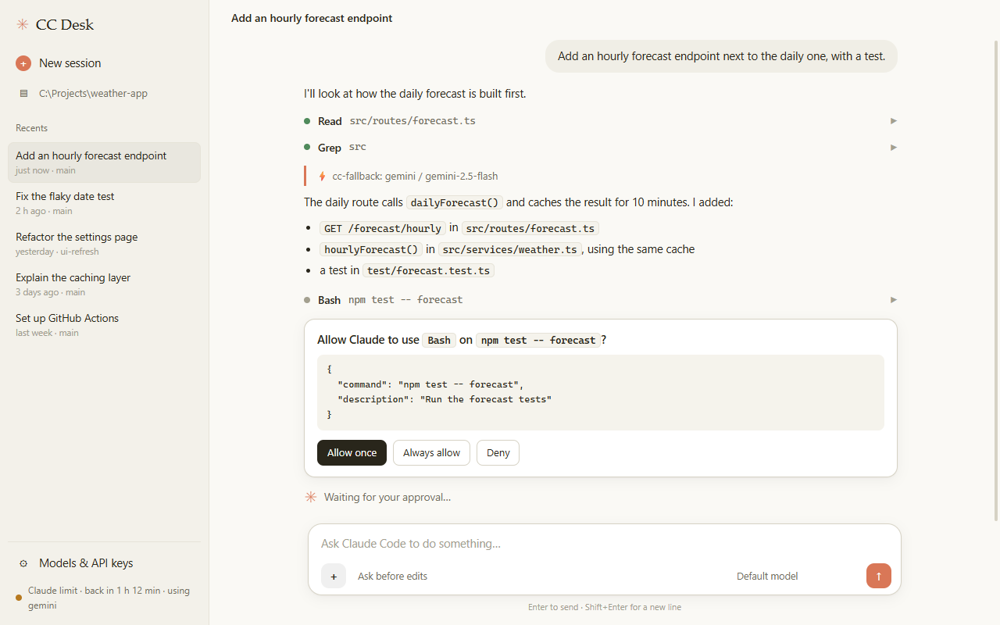

# CC Desk

The desktop app of [cc-fallback](../README.md), for **Claude Code**. It sends every request through the cc-fallback proxy: your Claude subscription is used first, and when its limit is reached free models (Gemini, Kilo, LLM7, NVIDIA, your own APIs, local models…) take over automatically.

The Claude desktop app gives its sessions its own API address, so it can't use cc-fallback. CC Desk runs the real Claude Code (via the [Claude Agent SDK](https://docs.claude.com/en/api/agent-sdk/overview)) and points it at the proxy.

[Türkçe](#türkçe)

## Features

- Claude Code look, light and dark: chat bubbles, streaming answers, compact tool rows (Bash, Read, Edit, …) that open to show input and output
- Approval cards (Allow once / Always allow / Deny) and permission modes (ask before edits, auto-accept edits, plan, auto, bypass)
- Sessions per folder, **including those from the Claude desktop app and the terminal**: open any of them and continue
- **Agent picker**: Claude Code, or **OpenCode** (bundled) with its free models; a chat belongs to one agent, and OpenCode chats are listed with an OpenCode tag
- **Handover at the Claude limit** (on by default, toggle in ⚙ Env): when cc-fallback reports Claude paused for its limit, the next message of a Claude Code chat goes to OpenCode with a free model and a summary of the chat; once the limit resets, the chat returns to Claude Code with a summary of the OpenCode part
- **Environments**: named sets of environment variables (stored in `~/.cc-desk/environments.json`), chosen next to the message box or in the ⚙ Env panel; both agents get them, secret values are masked in the UI
- Model picker: Claude models, or a free provider's model directly (`provider,model`); OpenCode's models when OpenCode is the agent
- Status bar: which provider answered, Claude's limit countdown, force a provider, retry Claude now; starts the proxy if it isn't running
- **Models & API keys** (bottom left):
  - add keys to the built-in providers (Gemini, Z AI, NVIDIA, …)
  - add any API: OpenAI-compatible, Anthropic-compatible, or a template (OpenAI, DeepSeek, Together)
  - add local AI: Ollama, LM Studio, llama.cpp, or any local URL
  - **Test & list models** checks the address and key and fills the model list
  - reorder providers and switch them on and off; **Save** writes `~/.cc-fallback/config.json` and the proxy reloads it at once
- **+** to attach files to a message
- **Log in to Claude** from inside the app (no separate Claude Code install needed)
- Local only: the server listens on 127.0.0.1 with a per-launch token



## Download (Windows)

Get `CC-Desk-Setup-<version>.exe` from the [latest release](https://github.com/smyrna-pergamum/Claude-Code-Fallback/releases/latest). It includes the proxy and Claude Code, so it needs neither Node nor a terminal. The installer isn't code-signed yet: if SmartScreen warns, click **More info → Run anyway**.

## Run from source

Needs Node 18+. The proxy is the parent folder of this one; the app starts it when needed, and offers a **Log in to Claude** button if you aren't logged in.

From the repository root:

```bash
npm run desk
```

Or from this folder:

```bash
npm install
npm start
```

Shortcuts on the Desktop and in the Start menu (Windows):

```bash
cscript scripts\create-shortcut.vbs
```

Browser mode (no Electron): `npm run web` prints a local URL.

## Notes

- Keys saved in **Models & API keys** are stored as plain text in `~/.cc-fallback/config.json` on this computer. Providers that use `env:VAR_NAME` keep reading the environment variable.
- Saving writes the whole provider list to that file; from then on it replaces cc-fallback's built-in list.
- For personal use with your own Claude login. Distributing an app that signs other people in with their Claude subscription may conflict with Anthropic's terms.
- Not a replacement for the official app: no diff viewer, browser pane, parallel sessions or plugins UI.

## Building the installer

```bash
npm run assets
```

```bash
npm run dist
```

`assets` renders `build/icon.png` and the README screenshots (`../docs/screenshots`) from demo content; `dist` writes `dist/CC-Desk-Setup-<version>.exe` with the proxy from the parent folder bundled in.

## Türkçe

CC Desk, cc-fallback'in Claude Code için masaüstü uygulaması. Tüm istekleri cc-fallback üzerinden gönderir: önce Claude aboneliğin kullanılır, limit dolunca ücretsiz modeller otomatik devreye girer. Claude masaüstü uygulaması oturumlarına kendi adresini verdiği için cc-fallback'i kullanamıyor; CC Desk gerçek Claude Code'u çalıştırıp proxy'ye yönlendirir.

- Açık ve koyu temada Claude Code görünümü; onay kartları ve izin modları.
- Eski oturumların (masaüstü uygulaması ve terminal dahil) klasöre göre listelenir; birini açıp devam edebilirsin.
- Model seçici (Claude ya da doğrudan ücretsiz model) ve cc-fallback durum çubuğu.
- Ajan seçici: Claude Code ya da ücretsiz modelleriyle uygulamaya gömülü **OpenCode**.
- **Ortamlar**: isimli ortam değişkeni setleri; mesaj kutusunun yanından ya da ⚙ Env panelinden seçilir, iki ajana da geçer.
- **Models & API keys** (sol altta): hazır sağlayıcılara anahtar ekle, kendi API'ni ekle (OpenAI veya Anthropic uyumlu), yerel yapay zekâ ekle (Ollama, LM Studio, llama.cpp ya da herhangi bir yerel adres), bağlantıyı test et, sırala ve aç/kapat. Kaydedince proxy hemen yeniden yükler. Anahtarlar bu bilgisayarda `~/.cc-fallback/config.json` içinde düz metin olarak saklanır.
- Windows kurulum dosyası: [son sürüm](https://github.com/smyrna-pergamum/Claude-Code-Fallback/releases/latest) (Node gerekmez; uygulama içinden **Log in to Claude** ile giriş yapılır). Kaynaktan: repo kökünde `npm run desk`. Masaüstü kısayolu için bu klasörde: `cscript scripts\create-shortcut.vbs`.
